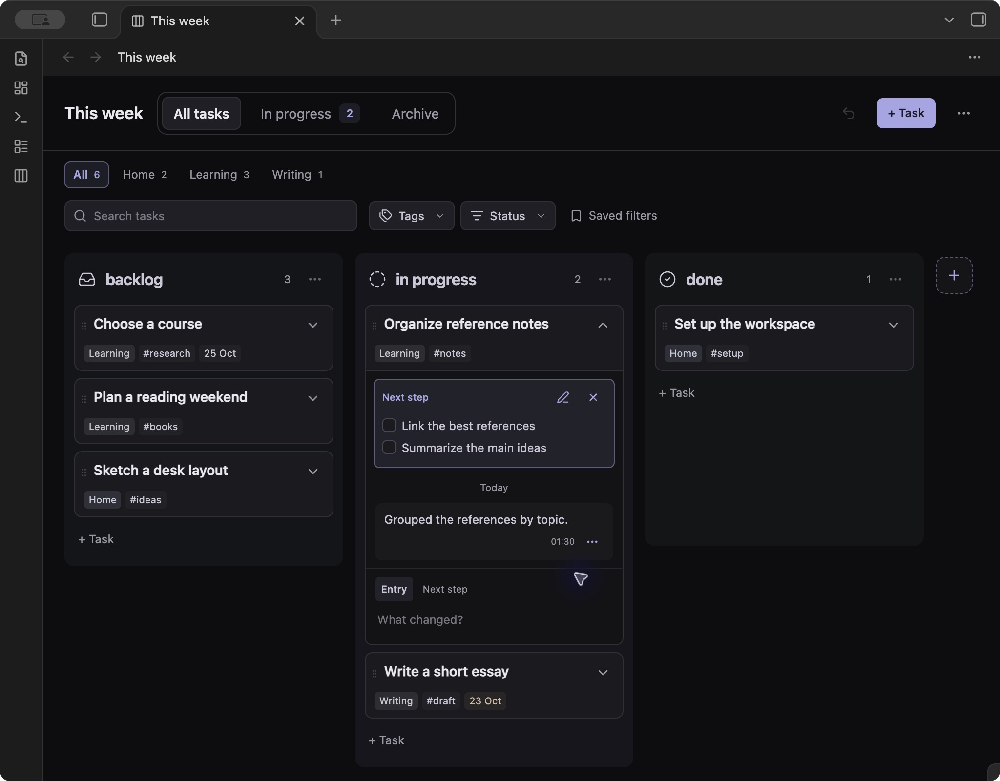

# PikoBoard

A task board for Obsidian, with the context of each task kept in its own Markdown note.

Keep the board small and readable. Open a card when you need its description, checklist, research or history. Pin a next step so you know where to pick up the work.



## Features

- **Boards you can shape.** Create named boards anywhere in your vault. Add, reorder and rename columns; choose their colors, background intensity and built-in Obsidian icons.
- **A clear next step.** Keep a short note or checklist on each task. One arrow reveals the next step and journal together.
- **Notes alongside the work.** Write descriptions, attach files, link research and add journal entries directly from the board. Entries can be edited, copied and deleted.
- **Optional structure.** Add a project, tags or a due date when useful. Search task content, combine filters and save views. A separate overview brings tasks from different boards together.
- **Small everyday details.** Subtle due-date highlights, task templates, automatic archiving and undo for task properties, moves and manual archiving.
- **Your theme.** Use the current Obsidian theme with `System`, or choose `pikoboard-dark` or `pikoboard-light`.

No other community plugins, account or paid service required.

## Install

PikoBoard is being prepared for the Obsidian Community directory. It is not listed there yet.

With the vault closed, run this from its root folder:

```sh
git clone https://github.com/ksumarshmallow/obsidian-pikoboard.git .obsidian/plugins/pikoboard
```

Open the vault, go to **Settings → Community plugins**, allow community plugins and enable **PikoBoard**. Refresh the installed plugin list or restart Obsidian if it does not appear.

The repository includes the built plugin, so installation does not require Node.js or a build. If your vault uses a different configuration folder, replace `.obsidian` in the path above.

For a manual installation, download the repository ZIP and copy `main.js`, `manifest.json`, `styles.css`, `LICENSE` and `THIRD-PARTY-LICENSES.txt` into `.obsidian/plugins/pikoboard/`. Once releases are published, the same runtime files will be available as release assets.

## Get started

1. Open **Settings → PikoBoard → Create board**, then choose a name and folder.
2. Select **+ Task**, enter a title and press **Enter**.
3. Open the title to write a description or add task properties. Changes save automatically.
4. Drag the card between columns. Use its arrow to read or write the next step and journal without leaving the board.

Controls, settings and commands are in English. See the [user guide](docs/usage.md) for the full workflow.

## Update

Close task editors and disable PikoBoard before replacing its files. For a Git installation, run from the vault root:

```sh
git -C .obsidian/plugins/pikoboard pull --ff-only
```

Enable PikoBoard again. For a manual installation, replace the five files listed above. Keep `data.json` – it contains preferences, drafts, card order and recoverable deleted entries. The Obsidian updater does not update this Git installation while the plugin is outside the Community directory.

## Data and privacy

Boards are `.pikoboard` files. Tasks, descriptions, journal entries and next steps live in Markdown files in your vault. Local plugin state lives in the plugin's `data.json`. Folder locations are configurable, including per-board task and attachment folders.

PikoBoard has no telemetry, account system, background network requests or self-updater. It does not read another plugin's configuration. Attaching a file copies the file you select into the vault. External links and embedded resources are handled by Obsidian's renderer and may access the network when opened or rendered. Synchronization is handled by your existing vault sync setup.

The default automatic archive interval is seven days after completion. Archiving keeps the note; deleting a task asks for confirmation and follows Obsidian's deletion preference.

## Compatibility and limits

- Requires **Obsidian 1.14.4 or newer**. Desktop checks were performed on macOS. Mobile behavior has not been verified.
- One board and one optional project per task. This is a personal planner, without assignments or real-time collaboration.
- Search covers task content, not the contents of linked notes or attachments.
- The formatted description editor uses an internal Obsidian API. A plain Markdown textarea remains available if that editor cannot load.
- Undo covers the last task property change, move or manual archive action in the current session. It does not restore deleted task files or board settings.

## Documentation and contributing

- [User guide](docs/usage.md)
- [Development](docs/development.md)
- [Release and directory submission](docs/releasing.md)
- [Report a bug](https://github.com/ksumarshmallow/obsidian-pikoboard/issues)

Bug reports are most useful with a small reproduction, plugin and Obsidian versions, and the active theme. Use sample notes and remove personal content from screenshots and logs.

## License

[MIT](LICENSE). The embedded editor adapter is based on an MIT-licensed technique by Matthew Meyers and Fevol; see [third-party notices](THIRD-PARTY-LICENSES.txt).
